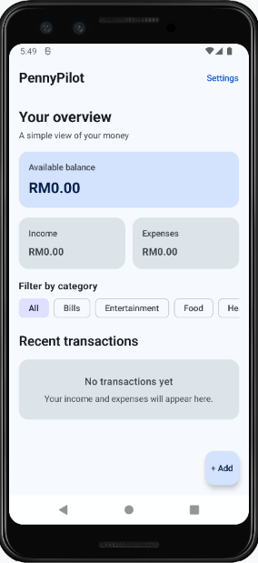
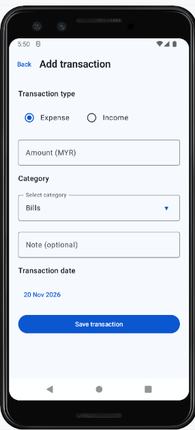
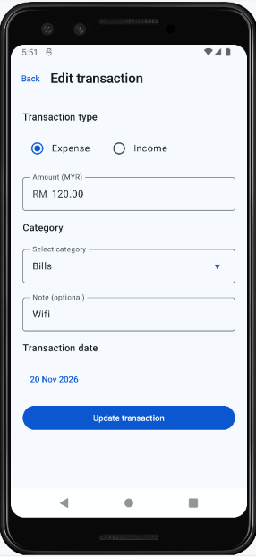
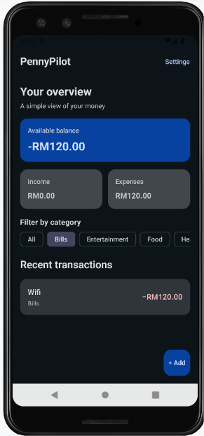
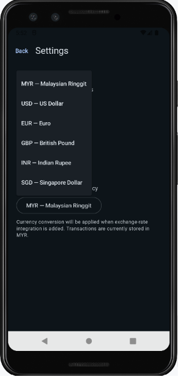
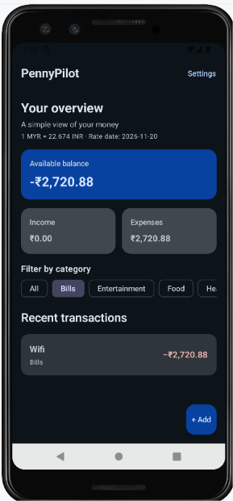
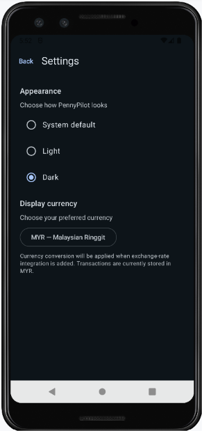

# PennyPilot

A native Android personal finance tracker built with Kotlin and Jetpack Compose.

PennyPilot lets users record income and expenses, review financial summaries, filter transactions by category, and choose their preferred theme and display currency.

## Features

- Dashboard with balance, income, expenses, and recent transactions.
- Add and edit income and expense transactions.
- Filter transactions by category.
- Persist transactions and categories locally with Room.
- Save theme and display-currency preferences with DataStore.
- Convert displayed MYR amounts using the latest Frankfurter exchange rate for the selected display currency.
- Show the applied exchange rate and its published date on the dashboard.
- Fall back to MYR display values if the exchange-rate request fails.

**Currency handling:** Transaction amounts are stored in MYR. Conversion affects display values only; it does not change the stored transaction amounts.

## Exchange rate behavior

- **Provider:** [Frankfurter API](https://frankfurter.dev/) (no API key required).
- **Request:** PennyPilot calls the latest single-pair rate endpoint, for example:
  `GET https://api.frankfurter.dev/v2/rate/MYR/USD`.
- **Supported display currencies:** MYR, USD, EUR, GBP, INR, and SGD.
- **When rates are requested:** MYR is the default currency and does not require a network request. When another display currency is selected in Settings, PennyPilot requests the latest MYR-to-selected-currency rate.
- **Dashboard display:** The dashboard shows the applied rate (for example, `1 MYR = … USD`) and the rate date returned by the API.
- **Conversion behavior:** Transaction amounts are stored in MYR sen. The fetched rate is applied only when formatting dashboard summaries and transaction amounts; the stored values are never converted or changed.
- **Failure behavior:** If the request fails, PennyPilot displays amounts in MYR and shows an exchange-rate-unavailable message.

## Tech stack

Kotlin · Jetpack Compose · Material 3 · MVVM · Clean Architecture · Coroutines · Flow · Room · DataStore · Retrofit · Hilt · Navigation Compose

## Architecture

The app uses three layers: Presentation, Domain, and Data. See [Architecture](docs/ARCHITECTURE.md) for the layer responsibilities and data flows.

## Requirements

- Android Studio
- JDK 17
- Android SDK 37
- Android emulator or physical Android device

## Run the app

1. Clone the repository and open it in Android Studio.
2. Allow Gradle sync to complete.
3. Run the `app` configuration on an emulator or connected device.

The Frankfurter API integration does not require an API key.

## Tests

Run JVM unit tests:

```bash
./gradlew test
```

Run instrumented UI tests on a connected device or emulator:

```bash
./gradlew connectedAndroidTest
```

## Build

Generate a debug APK:

```bash
./gradlew assembleDebug
```

For a signed release APK, use **Build → Generate Signed Bundle / APK** in Android Studio, select **APK**, the `app` module, and the `release` build variant.

Keep the release keystore and passwords private. Never commit signing credentials.

## App configuration

| Property | Value |
|---|---|
| Application ID | `com.pennypilot.app` |
| Minimum SDK | 26 |
| Compile SDK | 37 |
| Target SDK | 36 |
| Java compatibility | 17 |
| Version | 1.0 (1) |

## Screenshots

| Dashboard | Add transaction |
|---|---|
|  |  |

| Edit transaction | Category filter |
|---|---|
|  |  |

| Currency selection | Exchange rate |
|---|---|
|  |  |

| Dark theme |
|---|
|  |
